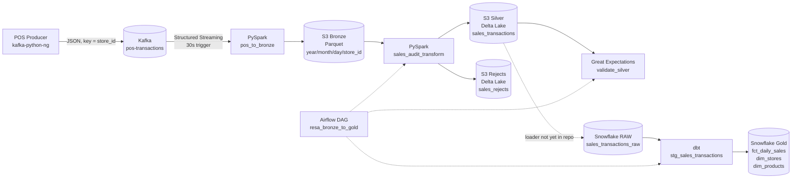
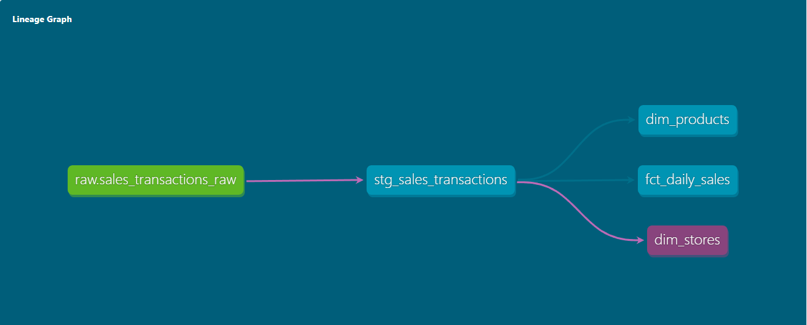

# RetailNexus DE

An end-to-end retail sales-audit data platform that streams point-of-sale transactions through Kafka, PySpark, Delta Lake, and dbt.

[](https://github.com/sanjana-kulenavar/retailnexus-de/actions/workflows/ci.yml)


---

## Overview

Retail point-of-sale systems produce a continuous, high-volume stream of
transactions. Before that data can support reporting, it has to be captured
without loss, deduplicated, checked against business rules, and separated into
valid sales and audit exceptions. This is the problem domain of retail sales
audit systems such as Oracle Retail ReSA.

RetailNexus DE reproduces that workflow with a modern data stack:

- A producer simulates POS transactions for 50 Dutch stores and publishes them
  to Kafka, keyed by `store_id`.
- PySpark Structured Streaming lands the raw stream in an S3 Bronze layer as
  partitioned Parquet.
- A PySpark batch job deduplicates, type-casts, and validates the data, then
  writes valid rows to a Silver Delta table and invalid rows to a rejects table.
- A Great Expectations suite validates the Silver table after each transform.
- dbt builds staging and mart models on Snowflake: a daily store-level sales
  fact and the `dim_stores` and `dim_products` dimensions.

### Project status

| Area | Status |
|---|---|
| Kafka ingestion (producer + Bronze consumer) | Implemented |
| Bronze → Silver transformation (dedupe, rules, audit flags) | Implemented |
| Silver data quality (Great Expectations) | Implemented |
| dbt staging + Gold marts | Implemented |
| Airflow orchestration | Implemented — Bronze → Silver → GX → dbt run → dbt test |
| Silver → Snowflake RAW automated load | In progress — load is still manual |
| Terraform infrastructure | Planned — directory reserved, no resources yet |
| Dashboards / serving layer | In progress — design documented, Superset not built |

---

## Architecture



The Airflow DAG orchestrates the Bronze → Silver transform, the Great
Expectations validation, `dbt run`, and `dbt test`, in that order. The
Silver → Snowflake RAW step is defined as a dbt source
(`RETAILNEXUS_PROD.RAW.sales_transactions_raw`) but the load itself is still
performed manually. A fuller description is available in
[`docs/ARCHITECTURE.md`](docs/ARCHITECTURE.md).

---

## Tech stack

| Layer | Technology | Version / configuration |
|---|---|---|
| Message broker | Apache Kafka (Confluent images) | `confluentinc/cp-kafka:7.6.1`, ZooKeeper-backed |
| Stream ingestion | PySpark Structured Streaming | `pyspark==3.5.3` |
| Transaction contract | Pydantic | `pydantic==2.7.4` |
| Kafka client | kafka-python-ng | `2.2.3` (Python 3.12 compatible fork) |
| Bronze storage | AWS S3, Parquet | Partitioned `year/month/day/store_id` |
| Silver storage | Delta Lake on S3 | `delta-spark==3.3.0`, version history and time travel |
| Data quality | Great Expectations | `great-expectations==1.18.1`, ephemeral context |
| Warehouse | Snowflake | dbt source: `RETAILNEXUS_PROD.RAW` |
| Transformation | dbt | `dbt-snowflake==1.8.4`, project `retailnexus_dbt` |
| Orchestration | Apache Airflow | `apache/airflow:2.9.2`, LocalExecutor |
| Local infrastructure | Docker Compose | Kafka, ZooKeeper, Kafka UI, Postgres, Airflow |
| CI | GitHub Actions | Black, Flake8, pytest |
| Cloud IaC | Terraform | Planned, no resources committed |

---

## Repository structure

```text
retailnexus-de/
├── .devcontainer/                  Dev container: Python 3.12, Java 17, Docker, AWS CLI
├── .github/workflows/ci.yml        CI: Black, Flake8, pytest
├── .env.example                    Template for local environment variables
├── airflow/
│   ├── Dockerfile                  Airflow image with Java 17 and project requirements
│   └── dags/resa_pipeline_dag.py   Daily DAG: transform → GX → dbt run → dbt test
├── dashboards/
│   └── README.md                   Planned Superset dashboard scope (not built)
├── data_quality/
│   └── validate_silver.py          Great Expectations suite for the Silver Delta table
├── dbt_project/
│   ├── profiles/                   Local dbt profile location (credentials gitignored)
│   └── retailnexus_dbt/
│       ├── dbt_project.yml         dbt project configuration (profile: retailnexus_dbt)
│       └── models/
│           ├── staging/            Source definition and stg_sales_transactions
│           └── marts/              fct_daily_sales, dim_stores, dim_products + tests
├── docs/
│   ├── ARCHITECTURE.md             Layer-by-layer architecture and design decisions
│   └── images/dbt_lineage.png      dbt-generated lineage graph
├── ingestion/
│   ├── kafka_consumer/pos_to_bronze.py        Kafka → S3 Bronze Structured Streaming job
│   └── kafka_producer/
│       ├── pos_transaction_producer.py        Simulated POS stream (10 txn/sec)
│       └── transaction_schema.py              Pydantic transaction contract
├── processing/
│   ├── spark_jobs/
│   │   ├── bronze_to_silver/sales_audit_transform.py   Dedupe, validation, audit flags
│   │   └── utils/                  Shared SparkSession and Delta helpers
│   └── tests/                      Manual verification and Delta history scripts
├── terraform/aws/                  Reserved for AWS infrastructure (empty)
├── docker-compose.yml              Kafka, ZooKeeper, Kafka UI, Postgres, Airflow
├── requirements.txt                Pinned Python and dbt dependencies
├── LICENSE                         MIT
└── README.md
```

---

## Data model

### Bronze — raw capture

The consumer reads JSON messages from `pos-transactions`, parses them against a
fixed Spark schema, and writes Parquet in append mode. Bronze is immutable and
partitioned by `year`, `month`, and `day` (derived from `transaction_ts`) plus
`store_id`.

Fields: `transaction_id`, `store_id`, `terminal_id`, `cashier_id`,
`product_id`, `quantity`, `unit_price`, `total_amount`, `payment_method`,
`transaction_ts`, `is_voided`, `audit_flag`, `kafka_received_at`.

Metadata columns added at ingestion: `year`, `month`, `day`, `ingested_at`,
`pipeline_name` (`resa-kafka-bronze`), `source_system`
(`POS_KAFKA_STREAM`), and `data_layer` (`BRONZE`).

Rows with null `transaction_id`, `store_id`, or `total_amount` are dropped
before the write. The stream checkpoints to
`/tmp/retailnexus_checkpoints/pos_bronze/`.

### Silver — deduplicated and validated

The batch transform reads all Bronze data and:

1. Deduplicates on `transaction_id`, keeping the row with the latest
   `ingested_at`.
2. Casts `transaction_ts` to a timestamp and computes
   `expected_total = round(quantity * unit_price, 2)`.
3. Assigns a `rejection_reason` using the rules below.
4. Recomputes `audit_flag` from `is_voided` and `total_amount`.
5. Overwrites the Silver table with valid rows and writes rejects separately.

| Rule | `rejection_reason` |
|---|---|
| `transaction_id` is null | `NULL_TRANSACTION_ID` |
| `store_id` is null | `NULL_STORE_ID` |
| `total_amount < 0` | `NEGATIVE_AMOUNT` |
| `abs(total_amount - expected_total) > 0.01` | `TOTAL_MISMATCH` |
| `store_id` does not match `^NL-[0-9]{3}$` | `INVALID_STORE_FORMAT` |

Valid rows go to `s3a://<silver-bucket>/sales_transactions/` as a Delta table
partitioned by `year`, `month`, `day`, with `silver_processed_at` and
`data_layer = 'SILVER'` added. Rejected rows go to
`s3a://<silver-bucket>/sales_rejects/` with the original identifiers, the
expected total, and the rejection reason.

#### `audit_flag` rules

The same classification is applied by the producer and re-applied in Silver, so
the downstream flag always reflects the current rule set:

| Condition | `audit_flag` |
|---|---|
| `is_voided = true` | `VOIDED` |
| `is_voided = false` and `total_amount > 5000` | `EXCEPTION_HIGH_VALUE` |
| Otherwise | `VALID` |

### Gold — dbt marts on Snowflake

`stg_sales_transactions` reads the Snowflake RAW source, casts the numeric and
timestamp columns, and filters out null transaction IDs. The marts are
materialized as tables.

| Model | Grain | Key columns |
|---|---|---|
| `fct_daily_sales` | One row per store per day | `store_id`, `year`, `month`, `day`, `transaction_count`, `valid_revenue`, `voided_count`, `avg_transaction_value` |
| `dim_stores` | One row per store | `store_id`, `country`, `store_number` |
| `dim_products` | One row per product | `product_id`, `times_sold`, `avg_price`, `max_price`, `min_price` |

`fct_daily_sales` is the ReSA-style daily audit summary: revenue counts only
`VALID` transactions, `voided_count` counts `VOIDED` transactions, and
`avg_transaction_value` is the average over all transactions in the group.
`dim_stores` is tested against the fact via a dbt `relationships` test.
`dim_products` currently describes product pricing behavior at the product
level and is not joined to the fact table.



*Lineage generated by dbt: Snowflake RAW source → `stg_sales_transactions` →
`fct_daily_sales`, `dim_stores`, and `dim_products`.*

---

## Data quality and testing

### Great Expectations on Silver

`data_quality/validate_silver.py` loads the Silver Delta table into Spark,
builds an ephemeral Great Expectations context, registers the DataFrame as an
asset, and runs a suite named `silver_sales_quality` with eight expectations:

| Expectation | Column |
|---|---|
| Values are not null | `transaction_id` |
| Values are not null | `store_id` |
| Values are between 0 and 100,000 | `total_amount` |
| Values are between 1 and 100 | `quantity` |
| Values are in `VALID`, `VOIDED`, `EXCEPTION_HIGH_VALUE` | `audit_flag` |
| Values are in `CARD`, `CASH`, `CONTACTLESS`, `VOUCHER` | `payment_method` |
| Values match `^NL-[0-9]{3}$` | `store_id` |
| Table has at least 1 row | table-level |

The script prints a per-expectation PASS/FAIL report and an overall result. It
does not write results back to a data quality store.

### dbt tests

Eleven tests are declared in `_staging.yml` and `_marts.yml`:

- `stg_sales_transactions`: `unique` and `not_null` on `transaction_id`;
  `not_null` on `store_id` and `total_amount`.
- `fct_daily_sales`: `not_null` on `store_id` and `transaction_count`;
  `relationships` from `store_id` to `dim_stores.store_id`.
- `dim_stores`: `unique` and `not_null` on `store_id`.
- `dim_products`: `unique` and `not_null` on `product_id`.

Run them with `dbt test` from `dbt_project/retailnexus_dbt`.

### Verification utilities

`processing/tests/` contains manual Spark checks rather than pytest unit tests:
`verify_bronze.py` (null counts, audit flag and payment mix, top stores),
`verify_silver.py` (duplicate check, total mismatches, negative amounts),
`delta_history.py` (Delta version history and time travel), and
`export_silver_csv.py` (local CSV export; the output path is configurable via
`SILVER_EXPORT_PATH`, default `silver_export.csv`). These scripts require live
S3 access and are not run in CI.

---

## Getting started

### Prerequisites

- Python 3.12 (the dev container and dependency set target 3.12)
- Java 17 (required by PySpark)
- Docker and Docker Compose
- An AWS account with read/write access to two S3 buckets for Bronze and Silver
- A Snowflake account with a database and schema matching the dbt source

### Environment variables

Create a `.env` file at the repository root from the committed template. Only
the variable names are listed here; never commit real credentials.

```bash
cp .env.example .env
```

| Variable | Used by | Default in code |
|---|---|---|
| `AWS_ACCESS_KEY_ID` | Spark, Airflow | none |
| `AWS_SECRET_ACCESS_KEY` | Spark, Airflow | none |
| `AWS_DEFAULT_REGION` | Spark, Airflow | `eu-west-1` |
| `KAFKA_BOOTSTRAP_SERVERS` | Producer, consumer | `localhost:9092` |
| `KAFKA_TOPIC_POS` | Producer, consumer | `pos-transactions` |
| `S3_BUCKET_BRONZE` | Consumer, transform, verification | `retailnexus-bronze-dev` |
| `S3_BUCKET_SILVER` | Transform, GX, verification | `retailnexus-silver-dev` |
| `SNOWFLAKE_ACCOUNT` | dbt (Airflow and local) | none |
| `SNOWFLAKE_USER` | dbt (Airflow and local) | none |
| `SNOWFLAKE_PASSWORD` | dbt (Airflow and local) | none |
| `SNOWFLAKE_WAREHOUSE` | dbt (Airflow and local) | `RETAILNEXUS_WH` |
| `SNOWFLAKE_DATABASE` | dbt (Airflow and local) | `RETAILNEXUS_PROD` |
| `SNOWFLAKE_SCHEMA` | dbt (Airflow and local) | `MARTS` |
| `SNOWFLAKE_ROLE` | dbt (Airflow and local) | `DBT_ROLE` |

dbt reads credentials from `dbt_project/profiles/profiles.yml`, which is
gitignored. Create it from the committed template:

```bash
mkdir -p dbt_project/profiles
cp dbt_project/profiles/profiles.yml.example dbt_project/profiles/profiles.yml
```

### Start local infrastructure

```bash
docker compose up -d
```

This starts ZooKeeper, Kafka, Kafka UI, Postgres, and the Airflow webserver and
scheduler. The `airflow-init` service migrates the metadata database and creates
a local admin user.

| Service | URL / port |
|---|---|
| Kafka broker | `localhost:9092` |
| Kafka UI | http://localhost:8080 |
| Airflow | http://localhost:8081 |
| Postgres | `localhost:5432` |

To run only the streaming stack, start `zookeeper kafka kafka-ui` explicitly.

### Run the pipeline

Producer (run from its directory so `transaction_schema` resolves):

```bash
cd ingestion/kafka_producer
python pos_transaction_producer.py
```

Bronze consumer:

```bash
python ingestion/kafka_consumer/pos_to_bronze.py
```

Bronze → Silver:

```bash
PYTHONPATH=processing/spark_jobs python \
  processing/spark_jobs/bronze_to_silver/sales_audit_transform.py
```

Great Expectations validation:

```bash
PYTHONPATH=processing/spark_jobs python data_quality/validate_silver.py
```

Optional verification:

```bash
PYTHONPATH=processing/spark_jobs python processing/tests/verify_bronze.py
PYTHONPATH=processing/spark_jobs python processing/tests/verify_silver.py
PYTHONPATH=processing/spark_jobs python processing/tests/delta_history.py
```

dbt (after the Silver data has been loaded into Snowflake RAW):

```bash
cd dbt_project/retailnexus_dbt
dbt run --profiles-dir ../profiles
dbt test --profiles-dir ../profiles
dbt docs generate --profiles-dir ../profiles
```

The Airflow DAG `resa_bronze_to_gold` runs daily and executes the Bronze →
Silver transform, the GX validation, `dbt run`, and `dbt test`. Each task runs
only if the previous one succeeds, and tasks retry twice with a two-minute
delay.

---

## CI/CD

`.github/workflows/ci.yml` runs on pushes and pull requests to `main`:

1. Checks out the repository and sets up Python 3.12.
2. Installs `black`, `flake8`, and `pytest`.
3. Runs `black --check --line-length 100` over `ingestion/`, `processing/`, and
   `airflow/`.
4. Runs `flake8 --max-line-length 100` over the same directories.
5. Runs `pytest processing/tests/ -v`.

The format, lint, and test commands end with `|| echo ...`, so the job does not
fail when there are no matching files or tests. The current `processing/tests/`
scripts are live-environment verification scripts, not pytest tests, and dbt and
Great Expectations are not part of CI.

---

## Roadmap

| Phase | Scope | Status |
|---|---|---|
| 1 | Dockerized Kafka, ZooKeeper, Airflow, Postgres; CI workflow | Complete |
| 2 | Kafka producer and Structured Streaming Bronze ingestion | Complete |
| 3 | Bronze → Silver Delta transform with dedupe, rules, audit flags | Complete |
| 3.5 | Great Expectations suite on Silver | Complete |
| 4 | dbt staging and Gold marts on Snowflake | Complete |
| 5 | Airflow orchestration of the full pipeline, including dbt | Complete |
| 5.5 | Automated Silver → Snowflake RAW load | In progress |
| 6 | Superset dashboard and final documentation | In progress — architecture doc complete, dashboard pending |
| 7 | Terraform AWS infrastructure (S3, IAM) | Planned |
| 8 | Automated pytest coverage for transform rules | Planned |

---

## License

Released under the [MIT License](LICENSE).
