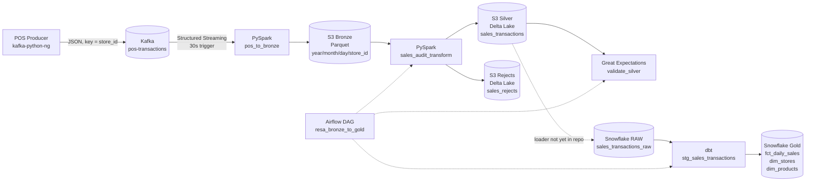

# RetailNexus DE — Architecture

This document describes how the RetailNexus DE sales-audit pipeline is
assembled, where each layer lives, and which parts are implemented today.

## Purpose

Retail POS systems emit a continuous stream of transactions. The platform
captures that stream, preserves an immutable raw copy, deduplicates and
validates records against sales-audit rules, and produces daily
store-level sales marts for reporting.

The business rules mirror Oracle Retail ReSA sales audit concepts:
transaction validation, duplicate rejection, void and high-value exception
classification, and a daily audit summary per store.

## End-to-end flow

## Layers

| Layer | Storage | Format | Purpose | Status |
|---|---|---|---|---|
| Ingestion | Kafka | JSON | Buffer the POS transaction stream | Implemented |
| Bronze | S3 | Parquet, partitioned | Immutable raw capture with ingestion metadata | Implemented |
| Silver | S3 | Delta Lake | Deduplicated, validated transactions | Implemented |
| Rejects | S3 | Delta Lake | Quarantined records with rejection reasons | Implemented |
| Quality gate | In-memory Spark DataFrame | Great Expectations suite | Block downstream use of bad Silver data | Implemented |
| RAW | Snowflake `RETAILNEXUS_PROD.RAW` | Table | Landing table for dbt | Load is manual / not scripted |
| Staging | Snowflake | dbt view | Type-cast and filter the RAW table | Implemented |
| Gold | Snowflake `MARTS` | dbt tables | Fact and dimension marts | Implemented |
| Orchestration | Airflow | DAG | Daily Bronze → Silver → GX → dbt | Implemented |
| Serving | Superset | Dashboard | Business-facing charts on Gold | Planned |

## Where the logic lives

| Concern | Location |
|---|---|
| Transaction contract and amount consistency check | `ingestion/kafka_producer/transaction_schema.py` |
| Synthetic stream generation | `ingestion/kafka_producer/pos_transaction_producer.py` |
| Kafka → Bronze streaming and partition/metadata columns | `ingestion/kafka_consumer/pos_to_bronze.py` |
| Deduplication, validation rules, audit reclassification | `processing/spark_jobs/bronze_to_silver/sales_audit_transform.py` |
| Spark session, Delta read/write helpers | `processing/spark_jobs/utils/` |
| Silver quality suite | `data_quality/validate_silver.py` |
| Staging and marts | `dbt_project/retailnexus_dbt/models/` |
| Scheduling and dependencies | `airflow/dags/resa_pipeline_dag.py` |

## Key design decisions

- **Kafka key = `store_id`.** All transactions for a store land on the same
  partition, preserving per-store ordering.
- **Bronze is append-only and partitioned by date and store.** The consumer
  never updates or deletes records; partitioning keeps downstream reads narrow.
- **Silver uses Delta Lake.** Deduplication keeps the latest record per
  `transaction_id` based on `ingested_at`, and Delta provides ACID writes and
  version history for auditing and time travel.
- **Invalid rows are quarantined, not dropped.** Every rejected record keeps
  its identifiers, expected total, and a stable `rejection_reason`.
- **Audit flags are recomputed in Silver.** Downstream consumers see the same
  classification rules regardless of what the producer sent.
- **Quality is enforced twice.** In-pipeline rules decide what enters Silver;
  Great Expectations independently validates the resulting table.
- **dbt owns warehouse transformations.** Models are version-controlled SQL
  with declared tests and generated lineage.
- **Orchestration stops on failure.** The Airflow DAG runs tasks sequentially,
  so a failed quality gate prevents dbt from rebuilding Gold.

## Failure and recovery behavior

- The Kafka consumer checkpoints to
  `/tmp/retailnexus_checkpoints/pos_bronze/`. Restarting the consumer resumes
  from the last committed offset; deleting the checkpoint resets the stream.
- The Silver transform overwrites the Silver and rejects tables on each run,
  making it idempotent for the current Bronze contents.
- Airflow tasks have two retries with a two-minute delay.
- A failed Great Expectations run stops the DAG before `dbt run`.

## Limitations and production scaling

- The Silver → Snowflake RAW step is manual: Silver is exported to CSV and
  loaded through the Snowflake UI. A production version would use Snowflake
  external stages, Snowpipe, or a managed ingestion tool.
- Spark runs with `master("local[*]")`; a production deployment would use a
  managed Spark service or a cluster.
- There is no dashboard yet. The planned Superset layer is documented in
  [`dashboards/README.md`](../dashboards/README.md).
- Terraform is reserved for future AWS infrastructure and currently contains
  no resources.
- Unit tests for transformation rules are not yet implemented; verification is
  performed by the scripts in `processing/tests/`.
